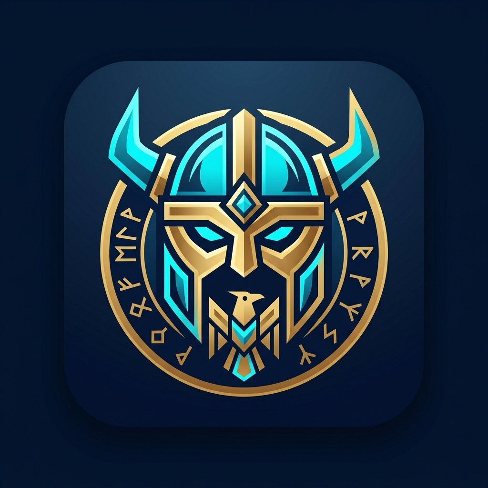
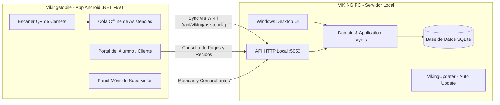

# VIKING — Plataforma Integral de Gestión y Control de Asistencia (PC & Mobile)

<p align="center">
  
</p>

<p align="center">
  <strong>Ecosistema integral para gestión de academias, gimnasios y centros deportivos: software administrativo de escritorio con sincronización local y app móvil en .NET MAUI con escaneo QR offline-first.</strong>
</p>

<p align="center">
  
  
  
  
  
  
</p>

---

## 🏗️ Arquitectura del Ecosistema

VIKING está diseñado bajo una arquitectura distribuida local, permitiendo operar tanto en escritorio como en dispositivos móviles conectados a la misma red local Wi-Fi, sin depender de servicios en la nube externos para la operación diaria.



---

## 🌟 Componentes del Proyecto

### 1. 💻 VIKING PC (`/VikingPC`)
Aplicación de escritorio para Windows desarrollada con Clean Architecture (`Domain`, `Application`, `Infrastructure`, `Presentation`):
* **Control de Alumnos y Carnets:** Generación de códigos QR, impresión de carnets y perfiles de miembros.
* **Multiactividad:** Gestión segmentada de múltiples disciplinas (Natación, CrossFit, Entrenamiento Funcional, etc.).
* **Planes Configurables:** Esquema por paquetes de clases (con contador de clases restantes) o membresías de 30 días.
* **Finanzas y Facturación:** Módulo de cobranzas con integración a tasa oficial de cambio (BCV), emisión de recibos digitales, folios correlativos y validación anti-duplicados de referencias de pago.
* **Servidor API Embebido:** Expone endpoints HTTP locales (puerto 5050) para la comunicación en tiempo real con la app móvil.
* **Auditoría y Respaldo:** Registro de trazabilidad de operaciones críticas y respaldos automáticos continuos.
* **VikingUpdater:** Módulo de actualización automática desde GitHub Releases con respaldo preventivo de datos.
* **Viking.Tests:** Suite de pruebas unitarias automatizadas para validación de lógica de negocio y cálculos.

### 2. 📱 VikingMobile (`/VikingMobile`)
Aplicación móvil multiplataforma desarrollada en **.NET MAUI** (optimizada para Android):
* **Escaneo QR con Tolerancia a Fallos (Offline-First):** Lee el carnet del alumno y valida el acceso. Si la conexión Wi-Fi con el servidor PC se interrumpe temporalmente, almacena las asistencias en una cola local encriptada y las reenvía automáticamente tan pronto se reanuda la red.
* **Modo Alumno / Cliente:** Permite a los miembros consultar su historial de asistencia, estados de cuenta, fechas de vencimiento de planes y comprobantes.
* **Modo Administrador Móvil:** Dashboard gerencial en la palma de la mano con alumnos activos, reportes diarios y validación de transferencias/pagos pendientes.
* **Diagnóstico y Resiliencia:** Sistema de logs locales diarios (`CrashLogger` / `AppLog`) para fácil auditoría y depuración.

---

## 🛠️ Stack Tecnológico

| Componente | Tecnologías |
| :--- | :--- |
| **Plataformas** | Windows Desktop (.NET 8) y Android Mobile (.NET MAUI / .NET 10) |
| **Lenguaje** | C# (últimas características de C#) |
| **Patrón Arquitectónico** | Clean Architecture (DDD en PC), MVVM en Mobile |
| **Persistencia** | SQLite (Microsoft.Data.Sqlite) |
| **Comunicación** | RESTful Local HTTP API + HttpClient + System.Text.Json |
| **Pruebas** | xUnit / MSTest (Viking.Tests) |
| **Hardware / Sensores** | Cámara Android para escaneo de códigos QR |

---

## 📁 Estructura del Repositorio

```text
VIKING/
├── VikingPC/                     # Software Administrativo Desktop
│   ├── Domain/                   # Entidades, Enums y Reglas de Negocio
│   ├── Application/              # Casos de uso, DTOs y Servicios
│   ├── Infrastructure/           # Persistencia SQLite, Servidor API Local, BCV, WhatsApp
│   ├── Presentation/             # Formularios WinForms/WPF y Componentes Visuales
│   ├── Viking.Tests/             # Proyecto de pruebas unitarias
│   ├── VikingUpdater/            # Actualizador automático desacoplado
│   └── VIKING.sln                # Solución del software PC
│
├── VikingMobile/                 # Aplicación Móvil (.NET MAUI)
│   ├── Application/              # Servicios de negocio, sincronización y autenticación
│   ├── Infrastructure/           # Canal HTTP y cola offline de asistencias
│   ├── Diagnostics/              # Sistema de registro de logs y fallos
│   ├── Platforms/Android/        # Configuraciones nativas Android y permisos de cámara
│   ├── Resources/                # Iconos, temas, estilos e imágenes
│   └── VikingMobile.csproj       # Proyecto .NET MAUI
│
├── docs/                         # Documentación técnica, contratos de sincronización y manuales
└── README.md                     # Documentación principal del ecosistema
```

---

## 👤 Autor
* **Josmar Alejandro** — [GitHub: @viking21121](https://github.com/viking21121) — [josmaralejandro21@gmail.com](mailto:josmaralejandro21@gmail.com)
